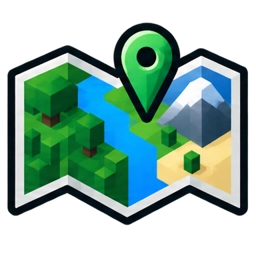
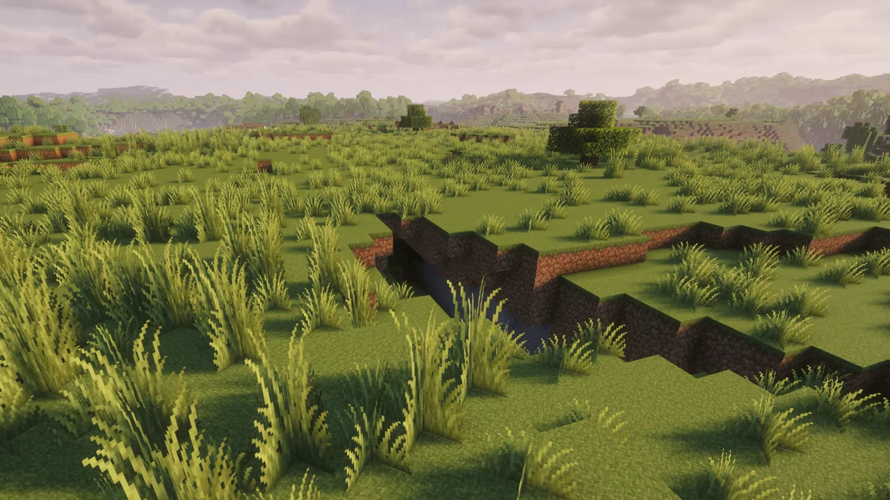
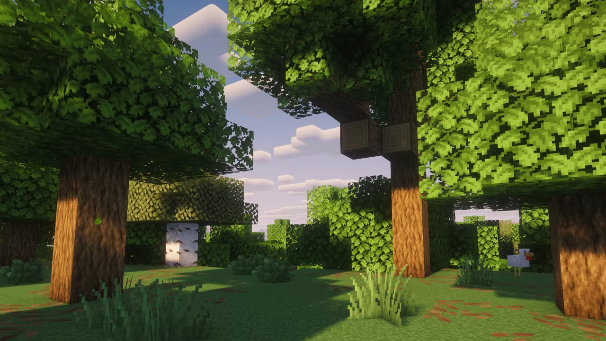
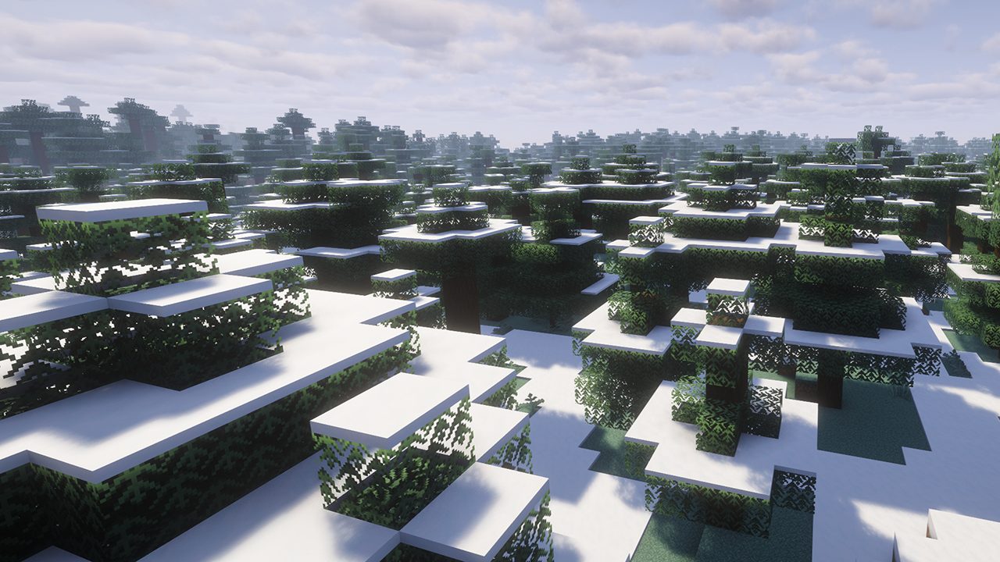

<div align="center">



# Seed Atlas

**Deine Welt beginnt mit dem richtigen Seed.**

Entdecke Minecraft-Biome, finde einen passenden Startpunkt und erkunde deine Welt auf einer interaktiven Karte – direkt im Browser.


[Funktionen](#was-seed-atlas-bietet) · [Erste Schritte](#erste-schritte) · [Installation](#lokal-starten) · [Deployment](#veröffentlichen) · [Fehler melden](https://github.com/CelduinX/mc-seed-atlas/issues)

</div>

---

## Was Seed Atlas bietet

| | Funktion | Das kannst du damit machen |
| :---: | :--- | :--- |
| 🌿 | **Startbiom finden** | Aus 29 Oberwelt-Biomen wählen und einen Seed mit dem gewünschten Biom am geschätzten Spawn suchen. |
| 🗺️ | **Seed Explorer** | Einen Seed eingeben, die Biomkarte verschieben und bis zur Blockauflösung hineinzoomen. |
| 🎮 | **Passende Minecraft-Version** | 30 Java-Releases von **1.18.2 bis 26.3**, einschließlich Hotfixes, erkunden. |
| 🌳 | **Zwei Weltvarianten** | Zwischen Standard und Großen Biomen wechseln. |
| 📥 | **Kartenausschnitt speichern** | Die sichtbare Karte als Bild herunterladen; WebP oder JPEG wird automatisch gewählt. |
| 🌍 | **Deutsch & Englisch** | Die Oberfläche nutzt deine Browsersprache und lässt sich jederzeit umstellen. |

Die Biomgenerierung und Seed-Suche laufen lokal im Browser. Dafür wird kein Minecraft-Server benötigt. Die Karte unterstützt Maus, Tastatur und Touch-Gesten.

### Einblicke in die Biomwelt

Die folgenden Bilder sind Minecraft-Biomaufnahmen aus dem Projekt, keine Screenshots der Bedienoberfläche.

<table>
  <tr>
    <td align="center" width="33%"><br /><strong>Ebene</strong></td>
    <td align="center" width="33%"><br /><strong>Wald</strong></td>
    <td align="center" width="33%"><br /><strong>Verschneite Taiga</strong></td>
  </tr>
</table>

## Erste Schritte

**Du suchst einen neuen Seed?**

1. Öffne **Startbiom** und wähle dein Wunschbiom.
2. Lege Minecraft-Version, Weltvariante und Biomgröße fest. Die Versionsauswahl zeigt nur Releases, in denen das gewählte Biom vorkommt.
3. Klicke auf **Seed finden**. Kopiere das Ergebnis oder öffne es direkt im Seed Explorer.

**Du möchtest einen vorhandenen Seed erkunden?**

1. Öffne den **Seed Explorer** und gib deinen numerischen Seed ein.
2. Wähle dieselbe Minecraft-Version und Weltvariante wie in deiner Welt.
3. Generiere die Karte, erkunde die Biome und lade bei Bedarf den sichtbaren Ausschnitt herunter.

> **Gut zu wissen:** Der angezeigte Weltspawn ist eine Schätzung. Die Karte zeigt einen Biomschnitt bei **Y=64**, keine Geländeoberfläche. Seltene Biome und große Suchradien können mehr Zeit benötigen.

## Unterstützte Versionen

| Minecraft Java | Verfügbare Releases |
| :--- | :--- |
| **1.18** | 1.18.2 |
| **1.19** | 1.19 und 1.19.1–1.19.4 |
| **1.20** | 1.20 und 1.20.1–1.20.6 |
| **1.21** | 1.21 und 1.21.1–1.21.11 |
| **26.x** | 26.1, 26.1.1, 26.1.2, 26.2 und 26.3 |

Standardwelten und Große Biome werden unterstützt. Die vollständige Versionszuordnung steht in [src/versions.ts](src/versions.ts).

## Lokal starten

Du benötigst **Node.js 24** und npm. Die fertigen WebAssembly-Dateien sind bereits enthalten; für den normalen Start brauchst du keine C-Toolchain und kein Docker.

```bash
git clone https://github.com/CelduinX/mc-seed-atlas.git
cd mc-seed-atlas
npm ci
npm run dev
```

Öffne anschließend **http://localhost:5173**.

<details>
<summary><strong>Alternativ mit Docker starten</strong></summary>

```bash
docker compose -f compose.dev.yaml up --build -d
```

Die Entwicklungsumgebung ist ebenfalls unter **http://localhost:5173** erreichbar.

```bash
docker compose -f compose.dev.yaml down
```

</details>

## Veröffentlichen

### Cloudflare Pages

```bash
npm ci
npm run build
```

Der fertige Webauftritt liegt in **`dist/`**. Für einen direkten Upload verwende diesen Ordner oder ein ZIP mit seinem **Inhalt**: `index.html` muss direkt auf der obersten Ebene liegen.

Für einen Git-basierten Build:

| Einstellung | Wert |
| :--- | :--- |
| Build-Befehl | `npm run build` |
| Ausgabeordner | `dist` |
| Node.js | `24` (über die mitgelieferte `.node-version`) |

Die Node-Version wird über die [Cloudflare-Build-Konfiguration](https://developers.cloudflare.com/pages/configuration/build-image/) festgelegt.

Die Biomaufnahmen werden aus `src/assets/biomes` importiert und beim Build nach `dist/assets` übernommen. Der Website-Build benötigt keine Bilddateien aus `docs`. Schriften und Font-Awesome-Icons werden über CDN geladen.

### Eigener Server mit Docker

```bash
docker compose up --build -d
```

Die Website ist unter **http://localhost:8080** erreichbar. Der Produktionsbuild kompiliert WebAssembly und liefert die statischen Dateien über Nginx aus.

## Grenzen und Projektstatus

- **Java Edition, Oberwelt:** Bedrock, Nether, End, Mods und benutzerdefinierte Datapacks sind derzeit nicht unterstützt.
- **Numerische Seeds:** Unterstützt werden vorzeichenbehaftete 64-Bit-Zahlen. Text-Seeds werden nicht angenommen.
- **Kartengrenzen:** X und Z reichen jeweils von −10.000 bis +10.000.
- **Historische Biomgrenzen:** Vor 1.19.3 kann Minecraft durch seinen damaligen Suchcache an einzelnen Grenzen von unabhängigen Kartenabfragen abweichen.
- **In Entwicklung:** Startseite und Seed Crafter zeigen derzeit einen WIP-Hinweis. Für Biomkarten ohne eigene Aufnahme erscheinen gekennzeichnete Platzhalter.

Die Details zur Genauigkeit und den Einschränkungen findest du in der [technischen Validierung](docs/seed-explorer-validation.md).

## Entwicklung und Qualität

**TypeScript · Vite · Tailwind CSS · WebAssembly · Cubiomes**

```bash
npm run typecheck   # TypeScript prüfen
npm test           # Generator-, Worker- und Bedienungstests
npm run build      # Produktionsbuild erstellen
```

Die Referenzprüfung umfasst **884.160 unabhängige Vanilla-Punktabfragen** über alle 30 Releases und beide Weltvarianten sowie **300 native Spawn-Referenzen**. Details und Voraussetzungen für die Wiederholung stehen in [docs/seed-explorer-validation.md](docs/seed-explorer-validation.md).

<details>
<summary><strong>WebAssembly und Vanilla-Referenzen neu erzeugen</strong></summary>

WebAssembly neu kompilieren, mit Docker:

```bash
npm run build:wasm
```

Den vollständigen Vanilla-Vergleich unter Windows mit Java 25 und PowerShell ausführen:

```bash
npm run test:vanilla
```

Dieser Lauf lädt offizielle Serverdateien und gegebenenfalls deren Mappings, prüft die SHA1-Hashes und fragt den Vanilla-Biomgenerator ab. Minecraft wird dabei nicht als Server gestartet. Für die historischen Releases werden unabhängige Punktabfragen ohne den vorherigen Suchtreffer verglichen.

</details>

Weitere Hinweise: [Entwicklungsdokumentation](docs/development.md) · [Generatorquellen und Lizenzen](vendor/README.md)

## Mitmachen

Fehler gefunden oder eine Idee für Seed Atlas? Erstelle ein [GitHub Issue](https://github.com/CelduinX/mc-seed-atlas/issues). Bei Kartenfehlern helfen **Seed, Minecraft-Version, Weltvariante und X/Z-Koordinaten** besonders.

Für Änderungen am Code: Repository forken, einen eigenen Branch anlegen, die relevanten Prüfungen ausführen und einen Pull Request erstellen. Neue Biomaufnahmen gehören in `src/assets/biomes`; `docs/images` dient als Referenzsammlung.

## Credits und Lizenzhinweise

Seed Atlas wird von [CelduinX](https://github.com/CelduinX) entwickelt.

Die Biomgenerierung basiert auf [Cubiomes](https://github.com/Cubitect/cubiomes) von Cubitect; Versionsanpassungen stammen aus [SeedForge](https://github.com/fwsoapy/seedforge). Beide Komponenten stehen unter der MIT-Lizenz. Der Bildexport verwendet IJG libjpeg und einen WebP-Encoder aus `@jsquash/webp`.

Die Quellen, festgelegten Versionen und Lizenztexte sind unter [vendor/README.md](vendor/README.md) dokumentiert. Die ausgelieferte Website enthält sie unter `/wasm/LICENSES.txt`. Für den eigenen Anwendungscode ist derzeit keine separate Projektlizenz festgelegt.

---

<div align="center">
  <strong>Seed Atlas · Finde deinen Minecraft-Seed.</strong><br />
  <a href="https://github.com/CelduinX/mc-seed-atlas">GitHub-Projekt</a> · <a href="https://github.com/CelduinX/mc-seed-atlas/issues">Feedback & Fehlerberichte</a>
</div>
